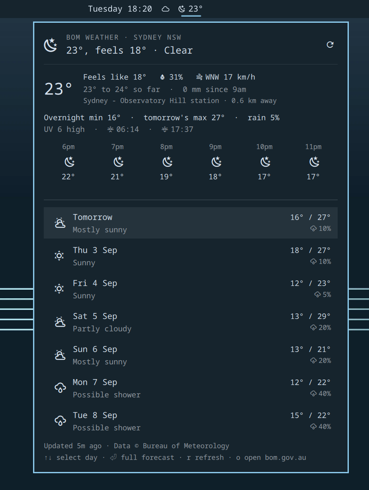

# BOM Weather for Omarchy

Australian [Bureau of Meteorology](https://weather.bom.gov.au) weather in the
Omarchy bar — the same data as the BOM app, instead of wttr.in's interpolated
guess.



A bar badge shows the current conditions and temperature from your nearest BOM
station, and lights up when the Bureau has a major warning out for your area.
Click it for a panel with live observations (feels-like, humidity, wind and
gusts, rain since 9am), today's detail (max/min, rain chance and amount, UV,
sun times, fire danger), the next hours, and the week ahead — expand any day
for the Bureau's full forecast text. New BOM warnings arrive as desktop
notifications.

> **Requires** Omarchy Quattro (`omarchy-shell`) and an Australian location —
> the Bureau forecasts nowhere else. No account, no API key. External
> dependencies are all part of a stock Omarchy install: `curl`, `jq`,
> `wl-copy` (wl-clipboard) and `flock` (util-linux). No sudo, no packages to
> install, no changes to your configuration beyond the plugin's own entry in
> `shell.json` that `omarchy plugin enable` writes.

## Install

```bash
omarchy plugin add https://github.com/zuccs/omarchy-bom-weather.git --enable
```

The widget lands in the center section of the bar, next to Omarchy's built-in
weather pill. They coexist happily, but if this is your weather now:

```bash
omarchy plugin disable omarchy.weather
```

(`omarchy plugin enable omarchy.weather` puts the built-in back any time.
Move ours with `omarchy bar move`.)

## Setup

Tell it where you are — a suburb, town or postcode:

```bash
omarchy bar set io.github.zuccs.bom-weather location "Brighton VIC"
```

That's it. The name is resolved once against the Bureau's location search and
cached. Four states have a Brighton, so add the state ("Brighton VIC") or use
the postcode ("3186") when a bare name is ambiguous — the first match wins,
and the panel header shows which one you got. Until a location is set, the
panel shows these same instructions with a copy button.

## Using it

| Where | Action |
|---|---|
| Badge — left click | Open / close the panel |
| Badge — middle click | Refresh now |
| Badge — right click | Open your location on weather.bom.gov.au |
| Panel — `↑` `↓` / `j` `k` | Move between forecast days |
| Panel — `Enter` / `Space` / click | Expand the Bureau's full text for the day |
| Panel — `r` | Refresh now |
| Panel — `o` | Open weather.bom.gov.au |
| Panel — `Tab` / `Shift+Tab` | Switch to the neighbouring bar panel |
| Panel — `Esc` | Close |

Bind a key in `~/.config/hypr/bindings.lua`:

```lua
o.bind("SUPER + CTRL + SHIFT + W", "BOM Weather", "omarchy-shell shell toggle io.github.zuccs.bom-weather")
```

## Uninstall

```bash
omarchy plugin remove io.github.zuccs.bom-weather
```

That removes the plugin directory and its `shell.json` entry. The response
cache is yours and is left alone; clear it if you want a clean slate:

```bash
rm -rf ~/.local/state/omarchy/bom-weather
```

If you added a keybind in `~/.config/hypr/bindings.lua`, delete that line too.

## Settings

Settings live inline on the widget's entry in `~/.config/omarchy/shell.json`,
like every Omarchy bar widget. The defaults:

```json
{ "id": "io.github.zuccs.bom-weather", "location": "", "refreshIntervalSec": 600, "badgeShows": "temp", "notifications": "On" }
```

| Key | Values | Meaning |
|---|---|---|
| `location` | free text | Suburb, town or postcode, optionally with a state. Resolved once via BOM's location search; first match wins. |
| `refreshIntervalSec` | `300`–`3600` | How often to poll. BOM observations update roughly every 10 minutes; the floor keeps the widget polite. |
| `badgeShows` | `temp` / `feels-like` | Which temperature sits on the badge. |
| `notifications` | `On` / `Off` | Desktop notification when the Bureau issues a new warning for your location. |

## How it behaves

- **Cached, politely.** The last good response is cached in
  `~/.local/state/omarchy/bom-weather/` (mode `0600`). Opening the panel or
  restarting the shell reads the cache; only the timer and explicit refreshes
  hit the API. If the network is down, the cached data stays on screen with an
  "showing data from …" note. Location lookups are cached indefinitely —
  suburbs don't move.
- **Several monitors, one round of requests.** Each monitor's bar hosts its own
  copy of the widget; the bridge serialises them with `flock`, so they share
  one fetch and one set of notifications.
- **Warnings degrade honestly.** A refresh where only the warnings endpoint
  fails keeps showing the warnings you already had — a network blip is never
  read as "all clear". New warnings notify (critical urgency for the Bureau's
  major group); a warning lapsing quietly disappears.
- **Observations are a real station**, not a grid-point estimate — the panel
  names it and its distance. A remote town with a forecast but no nearby
  station still works; the observations block just stays empty.
- **Metric only.** It's the Bureau of Meteorology; it speaks Celsius,
  kilometres and millimetres, and so does this widget.
- **Theme-native.** Colours, fonts, spacing and corner radius come from the
  shell's theme tokens, so it matches whatever Omarchy theme you switch to.

## Privacy & security

- The only network endpoint is `https://api.weather.bom.gov.au` — the public,
  keyless API behind the Bureau's own app and website. Nothing about you is
  sent beyond the location you configured; there is no IP geolocation. The
  only file written is the response cache above.
- That API is **unofficial**: undocumented, and its responses carry a BOM
  copyright notice reserving the data service. It has been stable for years
  and an ecosystem of open-source clients reads it, but the Bureau owes it to
  nobody — if it changes or goes away, this widget degrades to its cache and
  says so. The bridge sends an honest User-Agent and the refresh floor keeps
  usage well below what the BOM app itself generates.
- Everything the API returns is treated as untrusted. Response bodies are
  capped at 1 MiB before anything parses them, forecast/warning lists are
  capped before they reach the panel, and every remote string is flattened to
  a bounded line of plain text (forecast paragraphs to a bounded paragraph).
  Every `Text` in the panel is pinned to `Text.PlainText`, so no forecast
  string can turn into rich text and pull in a remote image.
- The state directory sits at a predictable path, so the bridge treats it as
  hostile: it refuses to use it if `omarchy/` or `bom-weather/` is a symlink,
  takes its cross-monitor lock on the directory itself (there is no lock file
  to plant), writes caches only via `rename(2)`, and reads them with a size
  cap and a timeout so a swapped-in FIFO or oversized file can't wedge the
  shell.
- `bin/bom-api` is ~400 lines of bash. Read it before you enable the plugin,
  as with any Omarchy plugin.

## Development

```bash
# Install the normal way — the result is a plain git checkout you can edit in place.
omarchy plugin add https://github.com/zuccs/omarchy-bom-weather.git --enable
cd ~/.config/omarchy/plugins/io.github.zuccs.bom-weather

omarchy plugin validate .
qmllint -I "$OMARCHY_PATH/shell" *.qml   # note: qmllint 1.0 rejects `function x(): void`, as it does on first-party Weather
node --test test/*.test.js               # Model.js is plain JS and unit-tested
bin/bom-api weather "brighton vic" --max-age 0 | jq   # the bridge works from any terminal
```

Saving files under `~/.config/omarchy/plugins/` hot-reloads most plugin kinds,
but bar-widget QML is currently cached until the shell restarts
([basecamp/omarchy#8555](https://github.com/basecamp/omarchy/issues/8555)) —
run `omarchy-restart-shell` after editing `BarWidget.qml` or `Panel.qml`.

Layout:

```
manifest.json     plugin identity, settings schema and defaults
BarWidget.qml     bar entry point: badge + Loader for the panel
Panel.qml         popup: fetch lifecycle, warning notifications, keyboard list
Model.js          pure functions (parsing, icon mapping, formatting, warning diffs)
bin/bom-api       the only code that touches the network
test/             node:test suite for Model.js
```

## Roadmap

- BOM rain radar (the Bureau publishes WMTS tiles) behind `o`, or inline.
- Tides and marine wind for coastal locations — the API already names the
  tidal point and marine area.

## License

MIT — see [LICENSE](LICENSE). Not affiliated with the Bureau of Meteorology or
Omarchy. Weather data © Commonwealth of Australia, Bureau of Meteorology.
